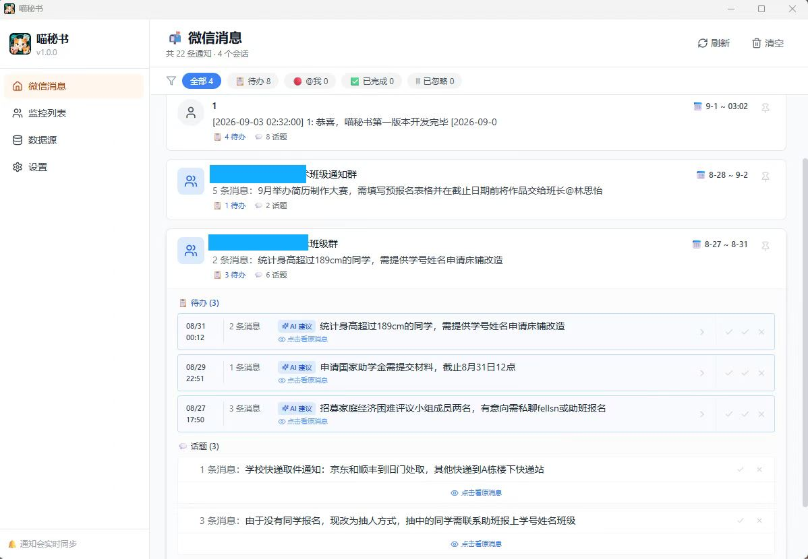
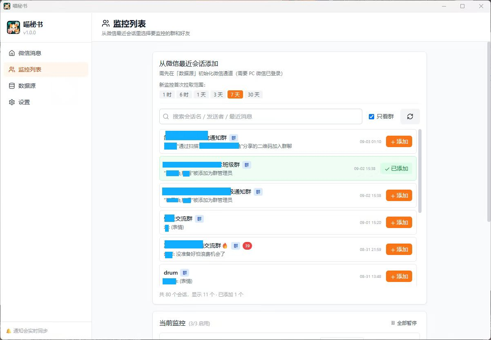
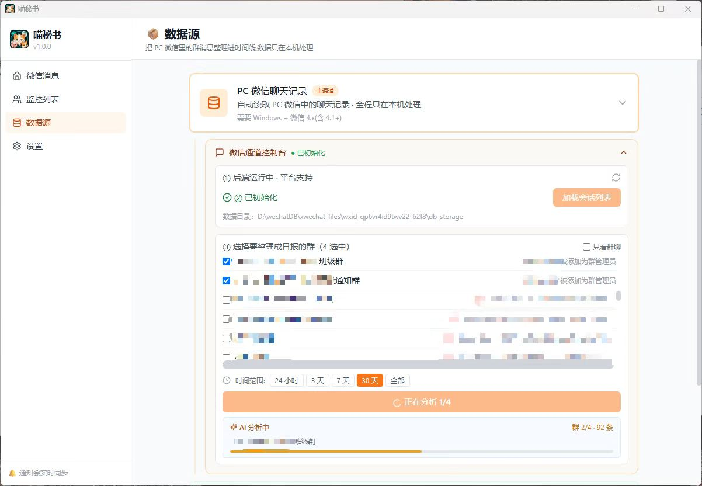
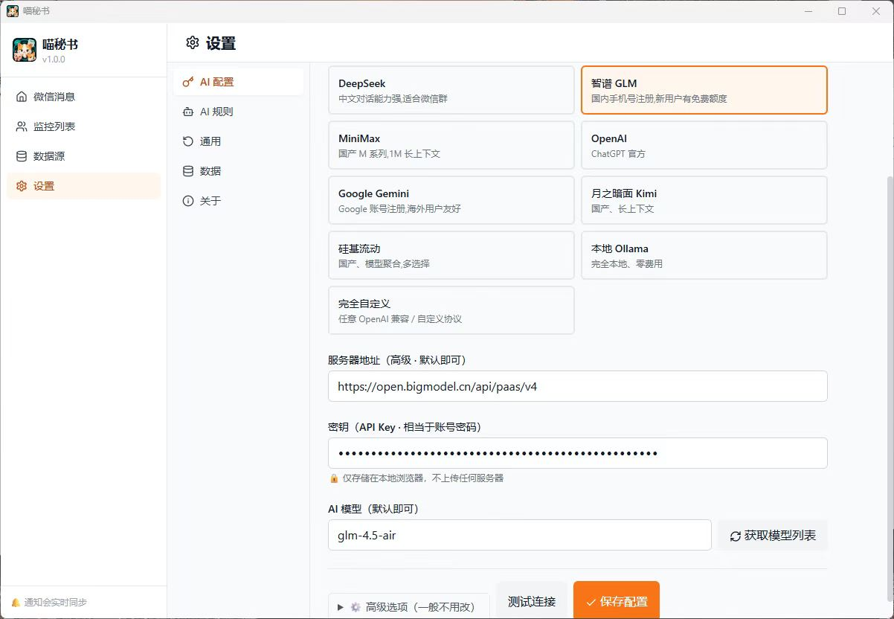
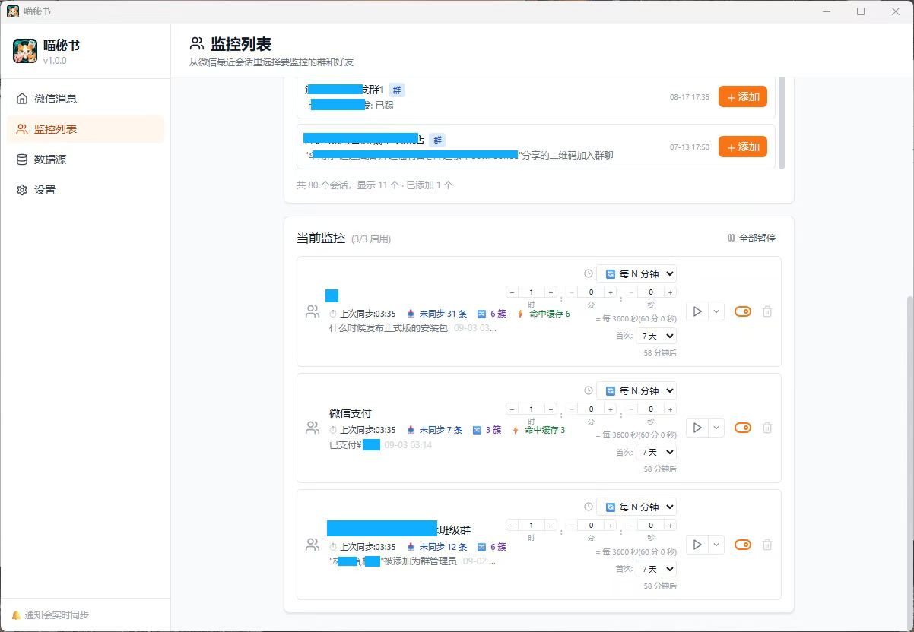
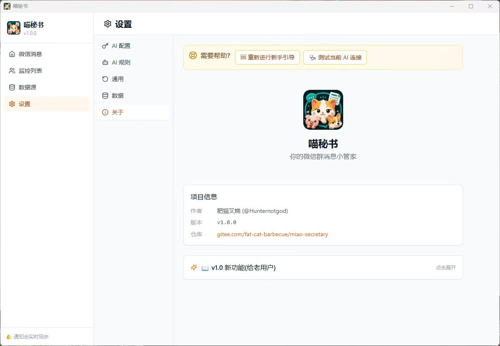

# 🐱 喵秘书 (MiaoSecretary)
##  :link: 下载链接: https://gitee.com/fat-cat-barbecue/miao-secretary/releases/download/v1.0.5/%E5%96%B5%E7%A7%98%E4%B9%A6_1.0.5_x64-setup.exe

> **PC 微信群消息 → AI 群日报 → 时间线** —— 群聊不再刷屏，关键消息一条不漏。

[](https://opensource.org/licenses/MIT)
[](https://gitee.com/fat-cat-barbecue/miao-secretary)
[](https://gitee.com/fat-cat-barbecue/miao-secretary/releases)

## 这是什么


喵秘书是一款桌面应用，帮 PC 微信用户把群消息整理成「群日报 + 时间线」：

- 📝 **AI 生成群日报** —— 每个群一份，几十条消息浓缩成几条要点
- ⏰ **关键信息自动提取** —— 时间 / 地点 / 截止日期 / 链接，结构化呈现
- 📚 **日报存入时间线** —— 所有日报统一管理，可检索可回看
- 🔁 **半实时同步** —— 定时轮询 + 手动触发，最新消息不遗漏
- 🛡️ **数据只在本机处理** —— 没有服务器，不收集任何东西

> **核心场景**：班级群通知、社团活动、课程变更、招聘推送 —— 这些「不看会死，看了又烦」的消息，喵秘书替你筛。

## 微信数据通道说明（重要）

- 本仓库公开的是**可开源的部分**：桌面 UI、AI 服务适配、日报/时间线、监控与设置等。
- **PC 微信本地聊天记录的读取通道是闭源组件**，不包含在本仓库中，本仓库也不会提供其实现细节或相关文档。
- 官方发布的 Windows 安装包内置该通道，可直接从 [Releases](https://gitee.com/fat-cat-barbecue/miao-secretary/releases) 下载体验完整功能。
- 从源码自行构建时，微信数据通道会显示「不可用 / 未连接」；其余功能（AI 配置、AI 规则、时间线等）不受影响。

##  :santa:  图片展示








## 🚀 从源码开发

### 环境要求

- Node.js ≥ 20
- pnpm ≥ 9
- Rust ≥ 1.77

### 步骤

```bash
# 1. 克隆仓库
git clone https://gitee.com/fat-cat-barbecue/miao-secretary.git
cd miao-secretary

# 2. 安装依赖
pnpm install

# 3. 前端开发模式(Vite)
pnpm dev

# 4. Tauri 桌面开发模式
pnpm tauri:dev

# 5. 打包
pnpm tauri:build
```

> 说明：微信数据通道为闭源组件，需要完整功能请使用官方发布版安装包。

## 🧠 AI 配置

应用支持任意 **OpenAI 兼容协议** 的 API。出厂预设的 provider：

| 服务 | 价格 | 备注 |
|---|---|---|
| **智谱 GLM-4-Flash** | 新用户免费额度 | 国内手机号即注册，推荐首选 |
| **DeepSeek** | 充值制，1 元能用很久 | 中文强、便宜 |
| **MiniMax** | 新用户免费额度 | 支持 1M 上下文 |
| **Google Gemini 2.0 Flash** | 新用户免费额度 | OpenAI 兼容，速度快 |
| **OpenAI** | 按量 | 贵但稳 |
| **月之暗面 Kimi** | 充值制 | 长上下文 |
| **硅基流动** | 充值制 | 模型丰富 |
| **本地 Ollama** | 完全免费 | 需装 Ollama |

> 模型名以官网最新列表为准。应用界面每个 provider 旁都有「查看可用模型」链接。

## 📂 项目结构

```
miao-secretary/
├── src/                       # React 前端
│   ├── components/            # UI 组件
│   ├── lib/                   # AI 适配 / 数据存储 / 监控调度
│   ├── pages/                 # 页面(时间线 / 监控 / 设置 / 数据源)
│   ├── assets/                # 应用图标等资源
│   ├── App.tsx
│   └── main.tsx
├── src-tauri/                 # Tauri 桌面壳(Rust)
│   ├── icons/                 # 应用图标(png / ico / icns)
│   ├── src/                   # Rust 命令与 sidecar 启动
│   └── tauri.conf.json
├── docs/
│   └── landing.html           # 产品介绍页(静态单页)
└── README.md                  # 你正在看这个
```

## 🏗️ 技术栈

| 层 | 技术 |
|---|---|
| 桌面壳 | [Tauri 2.0](https://tauri.app/) (Rust + WebView) |
| 前端 | React 18 + TypeScript + Vite + Tailwind CSS |
| AI | OpenAI 兼容协议(智谱 / DeepSeek / MiniMax / Google / OpenAI / Kimi / SiliconFlow / Ollama / 自定义) |
| 本地存储 | IndexedDB(Dexie) + Tauri SQLite 插件 |

## 🤝 贡献与反馈

欢迎在 [Issues](https://gitee.com/fat-cat-barbecue/miao-secretary/issues) 提交反馈，或直接发起 PR：

1. Fork 仓库
2. 创建 feature 分支(`git checkout -b feature/amazing-feature`)
3. 提交改动(`git commit -m 'feat: add amazing feature'`)
4. 推送分支(`git push origin feature/amazing-feature`)
5. 创建 Pull Request

> 注意：涉及 PC 微信本地数据读取通道的代码不在本仓库，相关 PR 不会被合并。

## 📜 License

- 本仓库代码基于 **MIT License** 开源，详见 [LICENSE](LICENSE)。
- PC 微信本地数据读取通道为**闭源专有组件**，仅随官方发布版提供，不适用本开源协议。

## ⚠️ 免责声明

- 请只整理、使用你**自己有权限访问**的聊天内容，遵守所在地法律法规与微信服务条款。
- 本软件不收集、不上传任何个人数据；AI 分析仅在你配置的 AI 服务上进行。

## 请肥猫叉烧喝杯奶茶


